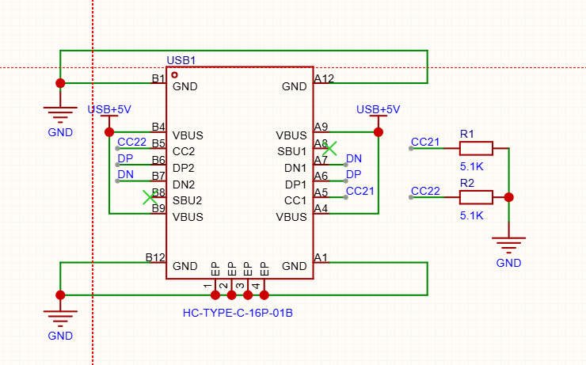
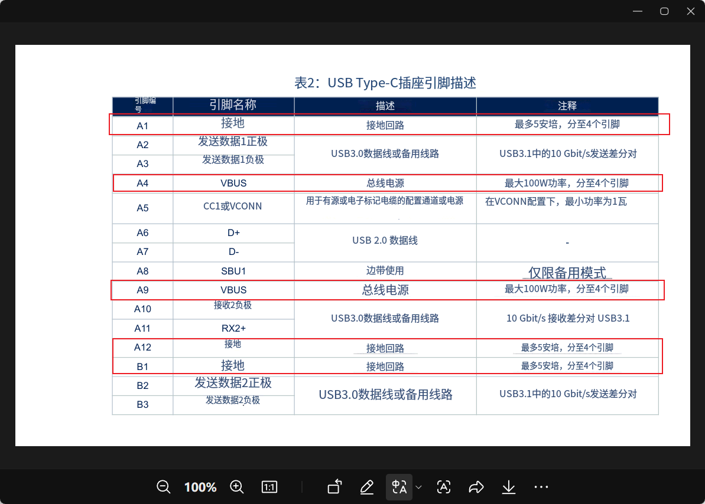
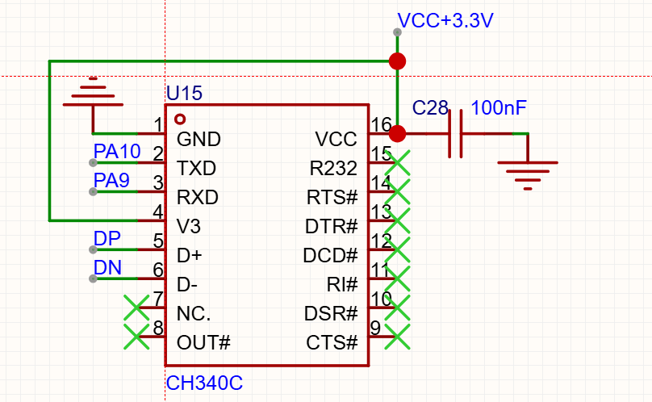
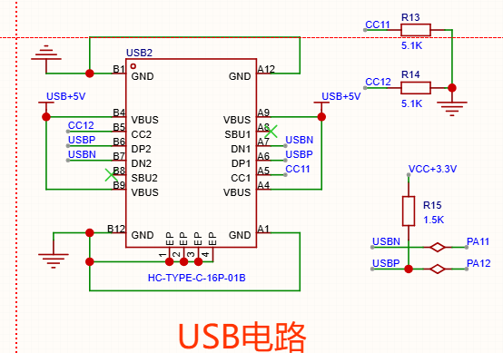

+++
date = '2026-10-22'
draft = false
title = 'USB 电路分析'
math = true
summary = '整理USB扩展电路，主要是USB 2.0'
categories = ['USB电路']
tags = ['MOSFET']
thumbnail = 'image.png'
+++
# 典型电路
> D+,D-走线需要走类差分，从引脚出来后，靠近着走，这样就算有电磁干扰，也不会影响电压差。

数据手册

# 原生USB 电路
> 需要写程序识别和处理USB数据，先看芯片是否支持USB外设，全速和高速操作通过嵌入式和/或外部PHY（开放系统互连模型的物理层）提供

芯片手册
> https://www.st.com/content/st_com/en/technical-documents/an4879-introduction-to-usb-hardware-and-pcb-guidelines-using-stm32-mcus-stmicroelectronics.html?utm_source=chatgpt.com#topic-an4879-protection-against-esd-and-emi