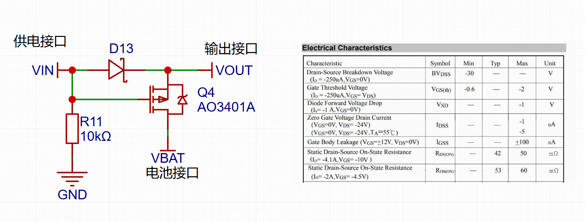

+++
date = '2026-10-12'
draft = false
title = '电源切换电路'
math = true
summary = '记录外部 5V 供电接入与断开时的电源切换过程，以及 MOSFET 体二极管和沟道的电流路径。'
categories = ['电源电路']
tags = ['MOSFET', '电源切换']
thumbnail = 'image.png'
+++

# 电源切换电路分析

- 电池（3.7V~4.2V）与供电接口（5V）,若电池电压高于输入电压则无法使用

## 供电接口接入

- VGSth不满足导通条件，Q4截止
- 5V电压比电池电压高，电池不会输出

### 电流方向

$$
\boxed{VIN(5V) \rightarrow D13 \rightarrow Vout}
$$

## 供电接口断开

- 电池电压经过体二极管，VGSth满足导通条件,mos管导通，由电池给负载供电

### 电流方向

#### MOSFET 体二极管先导通

$$
\boxed{VBAT(+) \rightarrow Q4体二极管 \rightarrow Vout \rightarrow 负载 \rightarrow GND}
$$

#### MOSFET 导通，电流改为主要通过沟道

$$
\boxed{VBAT(+) \rightarrow Q4(D) \rightarrow Q4(S) \rightarrow Vout \rightarrow 负载 \rightarrow GND}
$$

