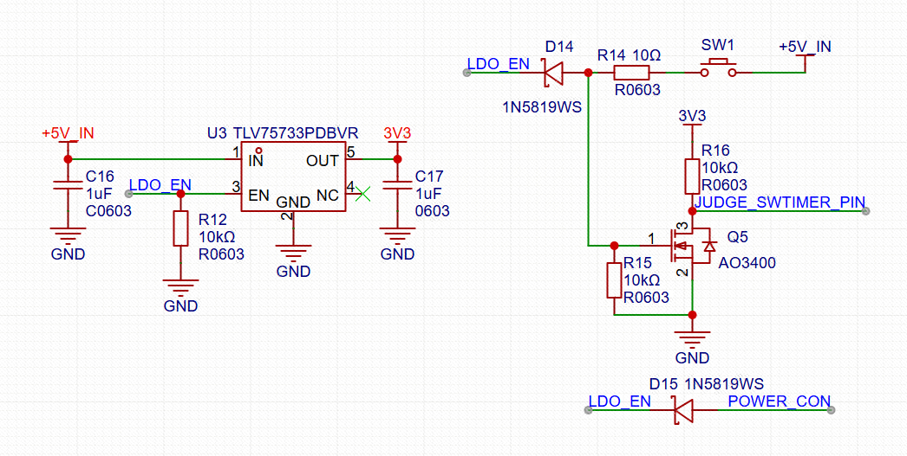

+++
date = '2026-10-13'
draft = false
title = '长按开关机电路'
math = true
summary = '记录长按开关机电路的使用前提，以及通过 JUDGE_SWTIMER_PIN 检测按键按下时长的思路。'
categories = ['电路设计']
tags = ['长按开关机']
thumbnail = 'image.png'
+++

# 长按开关机电路分析

- 条件（前提）：需要带有使能引脚的LDO或DCDC电源芯片
- 通过JUDGE_SWTIMER_PIN来检测按键按下的时长

